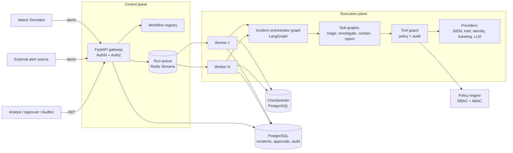
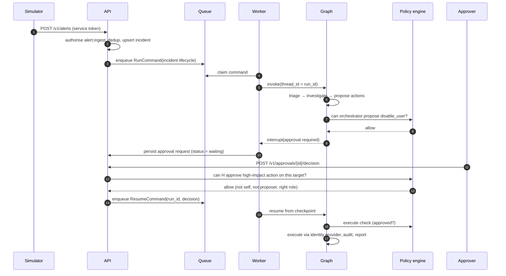

# 02 — High-Level Design

## 1. Architecture overview



The system separates a **control plane** (API: who may do what) from an **execution
plane** (workers running LangGraph graphs). They share only the database and the queue.

## 2. Components

| Component | Responsibility | Scales by |
|---|---|---|
| **API gateway** (FastAPI) | Authenticate (JWT/OIDC), authorise endpoint access, validate input, enqueue runs, serve reads | Replicas behind a load balancer (stateless) |
| **Workflow registry** | Versioned catalogue of graphs with required permissions and max action scope | In-process, loaded at start-up |
| **Run queue** | Durable hand-off of run/resume commands from API to workers | Redis Streams consumer groups |
| **Worker** | Pull a command, load/resume the graph from the checkpointer, run until done or interrupted | Replicas (KEDA on queue depth in K8s) |
| **Orchestrator graph** | Parent LangGraph that routes an incident through sub-graphs | — |
| **Sub-graphs** | One per workflow; small nodes with injected providers | — |
| **Tool guard** | Single choke point for side-effecting tool calls: policy check → execute → audit | — |
| **Policy engine** | Evaluate `(principal, action, resource, context)` → allow/deny + reason | Pure function; OPA sidecar later |
| **Audit log** | Append-only, hash-chained event store | Partitioned by tenant and month |
| **Providers** | Adapters to SIEM, threat intel, identity, ticketing, notifier, LLM | Swappable via config |
| **Simulator** | Seeded generator of attack and benign scenarios | CLI / container |

## 3. Main flow — alert to containment



## 4. Security architecture

Security is **layered**; each layer assumes the others may fail.

| Layer | Control | Phase |
|---|---|---|
| Identity | Signed JWTs (HS256 dev → RS256 via Keycloak OIDC). Short TTL. Service accounts for simulator and workers | 1 → 4 |
| Endpoint authZ | Each route declares a permission; dependency rejects with 403 | 1 |
| Workflow authZ | Registry entry declares `required_permission` to start a workflow | 1 |
| Tool authZ | Tool guard checks every side-effecting call with the *effective principal* | 2 |
| Attribute rules (ABAC) | Tenant match, team scope, no self-approval, separation of duties, two-person rule | 2 |
| Data isolation | `tenant_id` on every row; PostgreSQL row-level security | 4 |
| Data minimisation | PII redaction by role; PII redacted before LLM prompts | 2 |
| LLM containment | LLM sees data, never credentials. Output schema-validated. Actions restricted to the catalogue | 1–2 |
| Prompt-injection defence | Untrusted fields delimited and labelled; heuristic detector; detector hits are audited | 2 |
| Audit | Append-only, SHA-256 hash chain, verify endpoint | 2 |
| Secrets | `.env` in dev → Vault / cloud KMS later; never in code or prompts | 1 → 4 |

### Identity propagation (confused-deputy defence)

A workflow run stores the **initiating principal**. When a node calls a tool, the guard
computes the **effective permissions**:

```
effective = permissions(initiator) ∩ max_scope(workflow) ∩ permissions(orchestrator)
```

So an L1 analyst cannot use a workflow to do something they could not do directly,
and a workflow cannot exceed the scope declared in its registry entry.

## 5. LLM strategy

| Concern | Decision |
|---|---|
| Interface | `LLMProvider` protocol wrapping LangChain chat models |
| Tests | `FakeLLM` — scripted, deterministic, zero cost |
| Local dev | **Ollama** (e.g. `qwen2.5:7b` or `llama3.1:8b`) — free, offline |
| Hosted, low cost | **Claude Haiku 5.5** (`claude-haiku-5-5`, $0.10 / $0.50 per 1M input/output tokens) via `langchain-anthropic` |
| Cost control | Rules first; LLM only for classification and narrative; per-tenant token budget; cache identical prompts |
| Safety | Structured output (Pydantic) + validation; no tool execution by the LLM; actions picked from an allow-list |

Where the LLM is used: triage verdict + rationale, investigation narrative + ATT&CK
mapping, report writing. Where it is **not** used: severity maths, dedup, policy,
approvals, action execution.

## 6. Scalability and reliability

| Concern | Approach |
|---|---|
| Stateless compute | API and workers hold no session state |
| Durable state | LangGraph Postgres checkpointer; `thread_id = run_id` |
| Work distribution | Redis Streams consumer groups; at-least-once delivery |
| Idempotency | Actions carry an idempotency key `(run_id, action_id)`; providers ignore repeats |
| Crash recovery | Unacked messages re-claimed (`XAUTOCLAIM`); graph resumes from last checkpoint |
| Retries | LangGraph `RetryPolicy` on nodes calling providers; exponential back-off |
| Poison messages | After N deliveries → dead-letter stream + audit event |
| Fan-out | LangGraph `Send` for parallel enrichment lookups |
| Back-pressure | Per-tenant rate limit (token bucket in Redis) at the API |
| Autoscaling | HPA on API CPU; KEDA on queue length for workers (Phase 4) |

## 7. Deployment views

| Phase | Deployment |
|---|---|
| 1 | Single process: API + in-memory queue + in-memory checkpointer. `uv run` |
| 2–3 | Docker Compose: api, worker ×N, postgres, redis, ollama, (langfuse, prometheus, grafana) |
| 4 | Kubernetes via Helm: api Deployment + HPA, worker Deployment + KEDA, managed Postgres/Redis |

## 8. Observability (free, self-hosted)

- **Logs:** `structlog` JSON with `tenant_id`, `run_id`, `incident_id`, `principal` on every line.
- **Traces:** OpenTelemetry → Jaeger; LLM traces → Langfuse (self-hosted).
- **Metrics:** Prometheus (`runs_total`, `run_duration_seconds`, `queue_depth`,
  `policy_denials_total`, `llm_tokens_total`) → Grafana dashboard.

## 9. Technology choices

| Area | Choice | Why |
|---|---|---|
| Orchestration | LangGraph | Durable state, interrupts, sub-graphs, `Send` fan-out |
| LLM glue | LangChain core | Provider-neutral chat model interface, structured output |
| API | FastAPI + Pydantic v2 | Typed, async, OpenAPI for free |
| DB | PostgreSQL 16 | Checkpointer support, RLS, JSONB |
| Queue | Redis Streams | Free, simple, consumer groups, re-claim |
| Policy | In-code engine → OPA | Start simple and testable; same protocol later |
| Identity | PyJWT → Keycloak | Free OIDC provider; standard flows |
| Tooling | uv, ruff, pyright strict, pytest, import-linter | Fast, strict, enforces layering |

See the [ADRs](adr/README.md) for the reasoning behind the key decisions.
