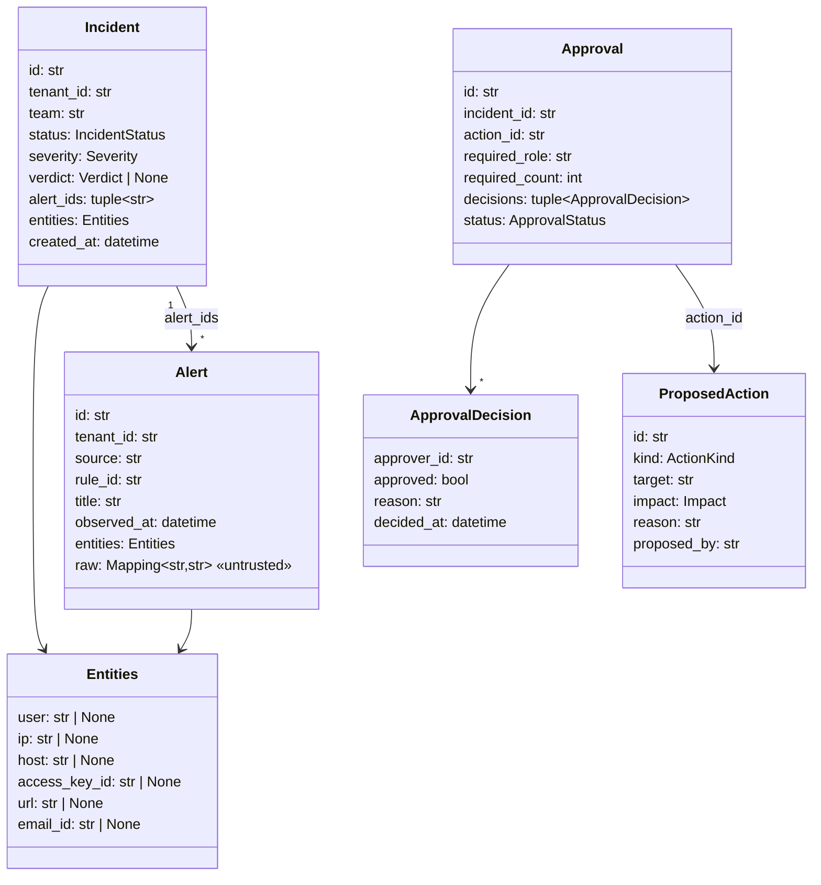
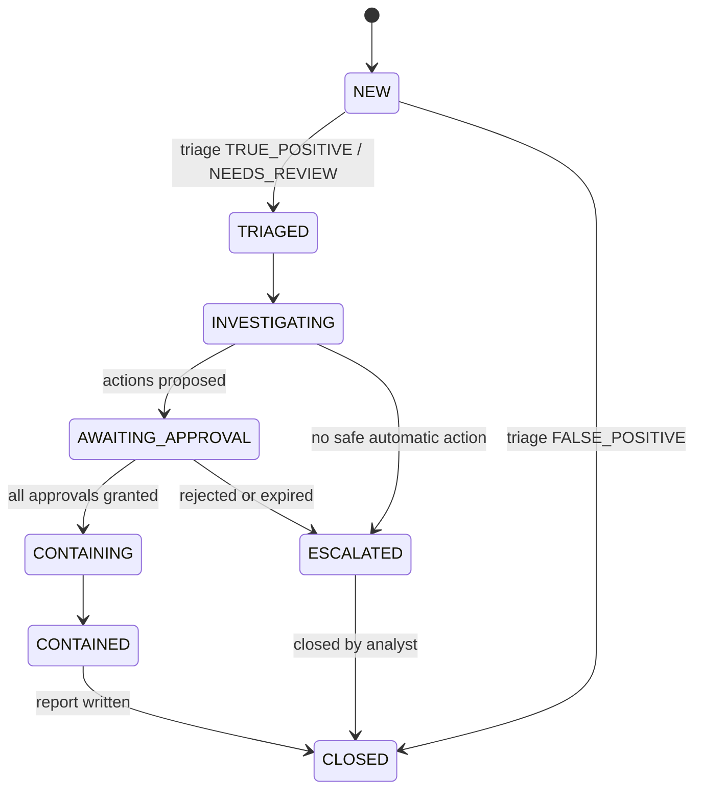

# LLD 01 — Domain Model

All domain types live in `sentinelflow/domain/`. They are **frozen dataclasses** (immutable,
hashable, cheap to test) with no I/O. Pydantic models appear only at boundaries (API,
LLM structured output, queue messages) and are mapped to domain types immediately.

## 1. Enumerations

```python
class Severity(IntEnum):        INFO=0  LOW=1  MEDIUM=2  HIGH=3  CRITICAL=4
class Verdict(StrEnum):         TRUE_POSITIVE  FALSE_POSITIVE  NEEDS_REVIEW
class IncidentStatus(StrEnum):  NEW  TRIAGED  INVESTIGATING  AWAITING_APPROVAL
                                CONTAINING  CONTAINED  ESCALATED  CLOSED
class Impact(StrEnum):          LOW  MEDIUM  HIGH
class ActionKind(StrEnum):      BLOCK_IP  FORCE_MFA_RESET  RESET_PASSWORD  PURGE_EMAIL
                                DISABLE_USER  REVOKE_ACCESS_KEY  ISOLATE_HOST
class ApprovalStatus(StrEnum):  PENDING  APPROVED  REJECTED  EXPIRED
class PrincipalKind(StrEnum):   USER  SERVICE
```

## 2. Core value objects



Other value objects:

| Type | Fields | Notes |
|---|---|---|
| `Principal` | `subject, tenant_id, team, roles: frozenset[str], kind` | Built from a verified JWT |
| `Enrichment` | `ip_reputation: IpReputation \| None, user: UserContext \| None, asset: AssetContext \| None` | Output of triage enrichment |
| `IpReputation` | `ip, score (0–100), categories: tuple[str, ...], country` | From threat-intel provider |
| `UserContext` | `user_id, department, is_privileged, mfa_enabled, usual_countries` | From identity provider |
| `TriageResult` | `severity, verdict, rationale, injection_suspected: bool` | Final triage output |
| `TimelineEntry` | `at, summary, event_id` | Investigation output |
| `AttackTechnique` | `technique_id, name, tactic` | e.g. `T1110 Brute Force` |
| `ActionResult` | `action_id, succeeded, detail, executed_at` | From the provider call |
| `AuditEvent` | `seq, tenant_id, at, actor, verb, resource, outcome, details, prev_hash, hash` | See LLD 03 §7 |

## 3. Action catalogue

The **only** actions the system can ever execute. The LLM can suggest kinds from this
list; anything else is rejected by validation.

| `ActionKind` | Target entity | Impact | Approval needed from | Approvals |
|---|---|---|---|---|
| `BLOCK_IP` | ip | LOW | `soc-analyst-l2` | 1 |
| `FORCE_MFA_RESET` | user | LOW | `soc-analyst-l2` | 1 |
| `PURGE_EMAIL` | email_id | MEDIUM | `soc-analyst-l2` | 1 |
| `RESET_PASSWORD` | user | MEDIUM | `soc-analyst-l2` | 1 |
| `DISABLE_USER` | user | HIGH | `incident-commander` | 1 (2 if incident is CRITICAL) |
| `REVOKE_ACCESS_KEY` | access_key_id | HIGH | `incident-commander` | 1 (2 if incident is CRITICAL) |
| `ISOLATE_HOST` | host | HIGH | `incident-commander` | 1 (2 if incident is CRITICAL) |

Implemented as a dictionary constant in `domain/actions.py` plus one pure function:

```python
def approval_requirement(kind: ActionKind, severity: Severity) -> ApprovalRequirement:
    """Return which role and how many distinct approvers an action needs."""
```

## 4. Pure business rules

Each rule is one small pure function in `domain/` with its own test file.

| Function | Rule |
|---|---|
| `fingerprint_alert(alert) -> str` | SHA-256 of `tenant_id, rule_id, sorted entity values` |
| `is_duplicate(fp, seen, window, now) -> bool` | Same fingerprint seen within the window (default 15 min) |
| `score_severity(rule_id, enrichment) -> Severity` | Table below |
| `apply_verdict(incident, result) -> Incident` | Returns a new incident with status `TRIAGED` or `CLOSED` |
| `approval_requirement(kind, severity)` | Catalogue above |
| `record_decision(approval, decision) -> Approval` | Appends a decision; computes the new status |
| `next_status(current, event) -> IncidentStatus` | Explicit state machine; illegal transitions raise `InvalidTransitionError` |

### Severity scoring

```
base      = RULE_BASE_SEVERITY[rule_id]                # e.g. brute_force_success → HIGH
+1 level  if ip_reputation.score >= 80
+1 level  if user.is_privileged
-1 level  if ip is internal and user is not privileged
clamped to [INFO, CRITICAL]
```

### Incident state machine



## 5. Errors

One hierarchy, rooted in `SentinelFlowError`:

```
SentinelFlowError
├── DomainError
│   ├── InvalidValueError       (value object invariant broken)
│   ├── InvalidTransitionError
│   └── UnknownActionError
├── AuthorizationError      (→ HTTP 403)
│   └── PolicyDeniedError(reason)
├── NotFoundError           (→ HTTP 404)
├── ConflictError           (→ HTTP 409, e.g. approval already decided)
└── ProviderError           (third-party failures, retryable flag)
    └── BudgetExceededError
```

Providers translate third-party exceptions into `ProviderError` at their boundary;
business logic never catches library-specific exceptions.
