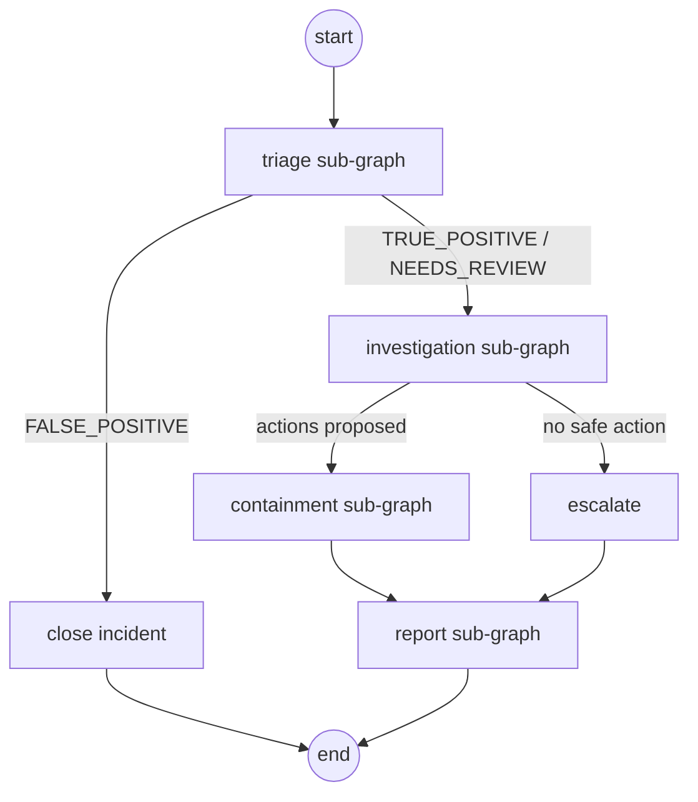
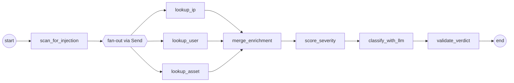
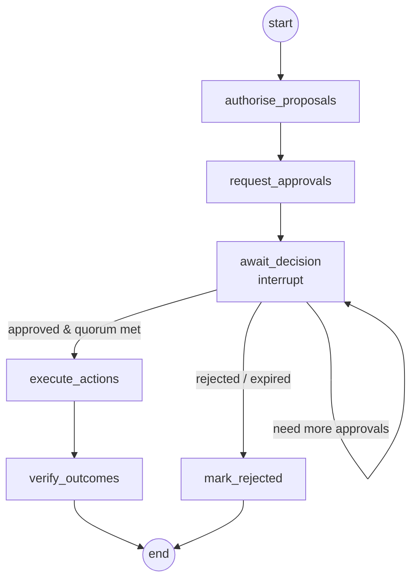

# LLD 02 — Workflows (LangGraph)

Every workflow is a compiled LangGraph `StateGraph`. Each one is registered in the
**workflow registry** and composed by the **orchestrator graph**.

## 1. Workflow registry

```python
@dataclass(frozen=True, slots=True)
class WorkflowDefinition:
    """A registered, versioned workflow and the permissions that govern it."""

    name: str                           # "triage"
    version: str                        # "1.0.0"
    required_permission: str            # needed to start it: "workflow:run:triage"
    max_scope: frozenset[str]           # most it may ever do: {"intel:lookup", ...}
    build: Callable[[Deps], CompiledGraph]
```

The registry is an immutable mapping built in `bootstrap.py`. Starting an unknown or
unauthorised workflow fails before anything is enqueued.

## 2. Shared conventions

- **State** is a `TypedDict`; domain objects inside it are frozen dataclasses.
- **Nodes** return *partial* updates (`dict`), never mutate state.
- **Every run** has `thread_id = run_id` so the checkpointer can resume it on any worker.
- **Run context** (`run_id`, `tenant_id`, `initiator: Principal`, `workflow`) is passed via
  LangGraph `config["configurable"]`, not state, so nodes cannot tamper with it.
- **Provider-calling nodes** get a `RetryPolicy(max_attempts=3, backoff_factor=2)` for
  `ProviderError(retryable=True)`.
- **Side-effecting calls** go through the tool guard (LLD 03 §6), never straight to a provider.

## 3. Orchestrator (incident lifecycle)



```python
class LifecycleState(TypedDict):
    incident: Incident
    triage: TriageResult | None
    investigation: InvestigationResult | None
    containment: ContainmentResult | None
    report: Report | None
```

Routing functions (`route_after_triage`, `route_after_investigation`) are pure functions
of state, tested with a table of inputs → expected next node.

## 4. Triage



| Node | Kind | Does |
|---|---|---|
| `scan_for_injection` | pure | Runs the injection detector over `alert.raw`; sets `injection_suspected` |
| `lookup_ip / user / asset` | provider | Parallel enrichment through `Send`; each tolerant of `None` entities |
| `merge_enrichment` | pure | Combines partial results (state reducer) |
| `score_severity` | pure | Calls `domain.severity.score_severity` |
| `classify_with_llm` | LLM | Structured output `TriageClassification(verdict, rationale)`; PII redacted first |
| `validate_verdict` | pure | If LLM output is invalid or injection suspected → `NEEDS_REVIEW` (fail safe, not fail open) |

## 5. Investigation

| Node | Kind | Does |
|---|---|---|
| `fetch_related_events` | provider | Queries the event store: same user/IP/host ±24 h |
| `build_timeline` | pure | Sorts and summarises events into `TimelineEntry` items |
| `retrieve_techniques` | provider | Retrieves candidate MITRE ATT&CK techniques (keyword index in Phase 2, vector store later) |
| `analyse_with_llm` | LLM | Structured output: narrative, chosen techniques (must be from candidates), suggested `ActionKind`s |
| `select_actions` | pure | Intersects suggestions with the playbook for the rule and the action catalogue; builds `ProposedAction`s |

The LLM may only pick techniques from the retrieved candidates and actions from the
catalogue — invented values are dropped and logged.

## 6. Containment (human-in-the-loop)



| Node | Does |
|---|---|
| `authorise_proposals` | Tool guard checks the *initiator* may propose each action; denied ones are dropped and audited |
| `request_approvals` | Creates `Approval` rows with role and count from `approval_requirement` |
| `await_decision` | `decision = interrupt({"approval_ids": [...]})`. The run stops; the worker marks it `waiting` |
| `execute_actions` | For each approved action: tool guard `execute` → identity provider; idempotency key `run_id:action_id` |
| `verify_outcomes` | Re-reads target state from the provider; records `ActionResult` |

**Resume path:** the approvals API validates the approver (LLD 03 §5), stores the
decision, and enqueues `ResumeRun(run_id, decision)`. A worker calls
`graph.invoke(Command(resume=decision), config)`. Quorum is recomputed from stored
decisions — the resume payload is only a trigger, never trusted for the decision itself.

## 7. Report

| Node | Does |
|---|---|
| `collect_facts` | Pure: gathers triage, timeline, techniques, actions, approvals from state |
| `write_report` | LLM: Markdown report from a fixed template; facts passed as data |
| `attach_ticket` | Provider: creates/updates a ticket with the report |

## 8. Access review (scheduled)

Runs per tenant on a cron trigger (`orchestrator` principal, read-only scope).

| Node | Does |
|---|---|
| `list_accounts` | Identity provider: all accounts with roles and last-login |
| `find_dormant` | Pure: no login for > 90 days |
| `find_over_privileged` | Pure: privileged role but no privileged activity in 30 days |
| `raise_findings` | Creates a LOW-severity incident per finding (re-enters the lifecycle) |

## 9. Ingestion (not a graph)

Ingestion is a plain service function because it must be fast and synchronous:

```
validate → fingerprint → dedup → attach to open incident or create new → enqueue StartRun
```

It runs in the API request; only the expensive work goes to the queue.

## 10. Testing a graph

1. **Node tests:** call the node function directly with a state dict and fakes.
2. **Routing tests:** table-driven tests of routing functions.
3. **Graph tests:** compile with `InMemorySaver` and fakes; run a scenario fixture;
   assert final state and audit events. For containment: run → assert interrupted →
   resume with a decision → assert executed actions on `FakeIdentityProvider`.
