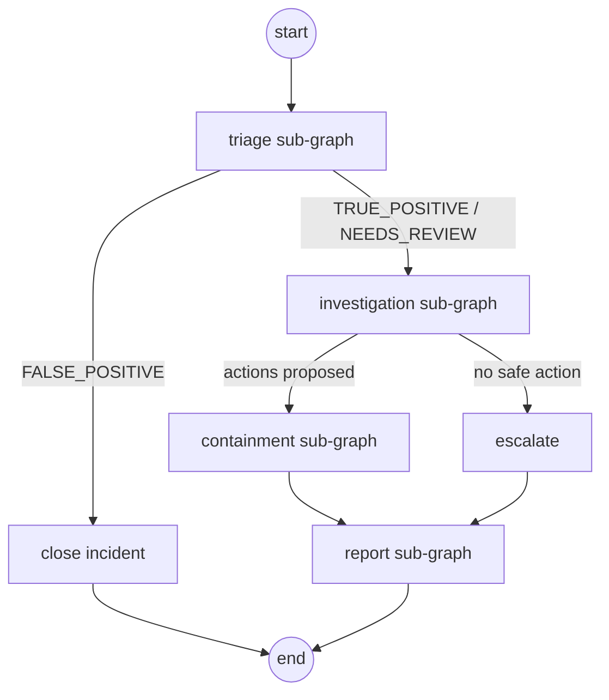
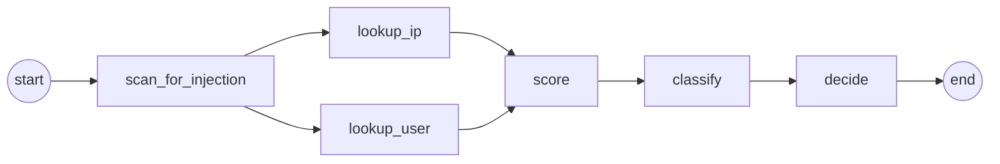
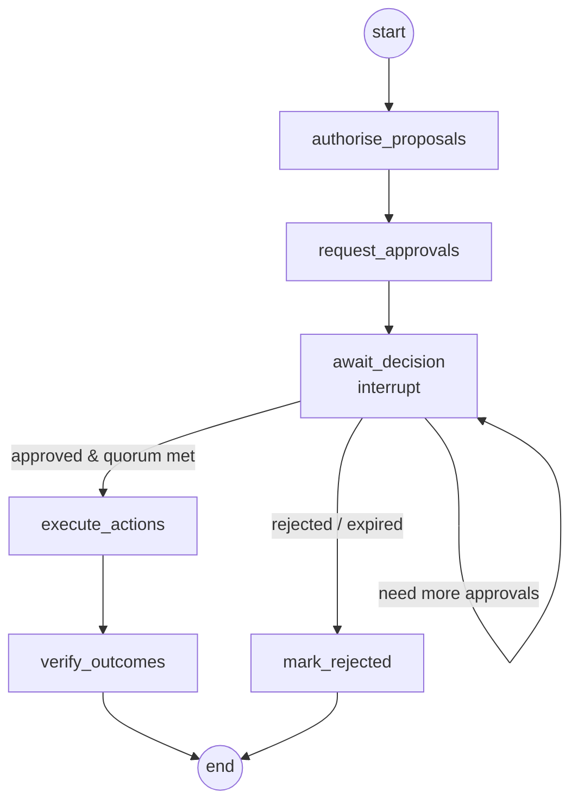

# LLD 02 — Workflows (LangGraph)

Every workflow is a compiled LangGraph `StateGraph`. Each one is registered in the
**workflow registry** and composed by the **orchestrator graph**.

## 1. Workflow registry

```python
@dataclass(frozen=True, slots=True)
class WorkflowDefinition:
    """A registered, versioned workflow and the permissions that govern it."""

    name: str                           # "triage"
    version: str                        # "1.0.0"
    required_permission: Permission     # needed to start it: workflow:run:triage
    max_scope: frozenset[Permission]    # most it may ever do: {intel:lookup, identity:read}
```

`WorkflowRegistry` (`workflows/registry.py`) offers `list()`, `get(name)` and
`authorize_start(principal, name)`, which raises `UnknownWorkflowError` (→ 404) or
`PolicyDeniedError("missing permission …")` (→ 403) **before** anything is enqueued.
`DEFAULT_REGISTRY` holds Phase 1's single entry, `triage`. Definitions carry metadata only;
the runtime maps a name to its compiled graph.

## 2. Shared conventions

- **State** is a `TypedDict`; domain objects inside it are frozen dataclasses.
- **Nodes** return *partial* updates (`dict`), never mutate state.
- **Every run** has `thread_id = run_id` so the checkpointer can resume it on any worker.
- **Run context** (`run_id`, `tenant_id`, `initiator: Principal`, `workflow`) is passed via
  LangGraph `config["configurable"]`, not state, so nodes cannot tamper with it.
- **Provider-calling nodes** get a `RetryPolicy(max_attempts=3, backoff_factor=2)` for
  `ProviderError(retryable=True)`.
- **Side-effecting calls** go through the tool guard (LLD 03 §6), never straight to a provider.

## 3. Orchestrator (incident lifecycle)



```python
class LifecycleState(TypedDict):
    incident: Incident
    triage: TriageResult | None
    investigation: InvestigationResult | None
    containment: ContainmentResult | None
    report: Report | None
```

Routing functions (`route_after_triage`, `route_after_investigation`) are pure functions
of state, tested with a table of inputs → expected next node.

**Implementation** (`workflows/orchestrator/`, see ADR 0007):

```
START → triage ─┬─ (closed: false positive) → END
                └─ investigate ─┬─ (no approvals requested) → END   [incident ESCALATED]
                                └─ await_decisions ⟲ (any pending) → contain → END
```

| Step | Does |
|---|---|
| `triage` | `run_triage` → `apply_triage` → save + `incident.triaged` |
| `investigate` | `run_investigation`; each proposed action goes through the tool guard (`action:propose` for the run's initiator) and becomes an `Approval`; incident → `AWAITING_APPROVAL` or `ESCALATED` |
| `await_decisions` | Re-reads approvals (expiring overdue ones); if any pending → `interrupt()` |
| `contain` | Executes each approved action via the tool guard (`action:execute`, quorum met) and `IdentityProvider.apply(action, idempotency_key)`; incident → `CONTAINED`, or `ESCALATED` if nothing was approved |

State is identifiers only; steps load/save through repositories. `run_lifecycle(graph, run)`
and `resume_lifecycle(graph, run_id)` return whether the run is still waiting. A repeated
`StartRun` continues an unfinished thread or is a no-op for a finished one.

## 4. Triage



| Node | Kind | Reads (`state.py`) | Does |
|---|---|---|---|
| `scan_for_injection` | pure | `TriageInput` | `security.injection.detect_injection` over alert title + raw values → `injection_indicators` |
| `lookup_ip` / `lookup_user` | provider | `TriageInput` | Run in parallel; skip the provider when the entity is absent |
| `score` | pure | `ScoreInput` | `domain.scoring.score_severity` — the LLM never influences severity |
| `classify` | LLM | `ClassifyInput` | Structured output `TriageClassification(verdict, rationale)`; alert text goes only into `Prompt.untrusted`. `ProviderError` or malformed output → `classification=None` |
| `decide` | pure | `DecideInput` | Fail safe: any injection indicator → `NEEDS_REVIEW` (indicators kept on `TriageResult`); no classification → `NEEDS_REVIEW`; LLM `FALSE_POSITIVE` on severity ≥ HIGH → `NEEDS_REVIEW`; otherwise the LLM verdict |

Each node declares the narrow `TypedDict` it reads (all keys required) and returns a partial
`TriageUpdate`; LangGraph passes each node exactly those keys. `run_triage(graph, incident,
alert) -> TriageResult` is the typed entry point.

An asset lookup joins the parallel enrichment later.

## 5. Investigation

| Node | Kind | Does |
|---|---|---|
| `fetch_related_events` | provider | `EventStore.related_events(EventQuery)`: same tenant, any shared entity value, ±24 h |
| `build_timeline` | pure | `domain.timeline.build_timeline`: time-ordered `TimelineEntry` items; consecutive repeats collapse ("login_failed x42") |
| `retrieve_techniques` | pure | `domain.attack.candidate_techniques`: keyword overlap with a curated 8-technique ATT&CK table (vector index later) |
| `analyse` | LLM | Structured output `InvestigationAnalysis(narrative, technique_ids, suggested_actions)`; candidates and allowed actions are trusted instructions, timeline and alert text are untrusted. Failure → `analysis=None` |
| `select` | pure | LLM may only **narrow**: techniques ∈ candidates, actions ∈ `domain.playbooks.playbook_for(rule)` with a target; rejected items listed in `InvestigationResult.dropped`. No LLM → playbook defaults (still need human approval) |

The LLM may only pick techniques from the retrieved candidates and actions from the
catalogue — invented values are dropped and logged.

## 6. Containment (human-in-the-loop)



| Node | Does |
|---|---|
| `authorise_proposals` | Tool guard checks the *initiator* may propose each action; denied ones are dropped and audited |
| `request_approvals` | Creates `Approval` rows with role and count from `approval_requirement` |
| `await_decision` | `decision = interrupt({"approval_ids": [...]})`. The run stops; the worker marks it `waiting` |
| `execute_actions` | For each approved action: tool guard `execute` → identity provider; idempotency key `run_id:action_id` |
| `verify_outcomes` | Re-reads target state from the provider; records `ActionResult` |

**Resume path:** the approvals API validates the approver (LLD 03 §5), stores the
decision, and enqueues `ResumeRun(run_id, decision)`. A worker calls
`graph.invoke(Command(resume=decision), config)`. Quorum is recomputed from stored
decisions — the resume payload is only a trigger, never trusted for the decision itself.

## 7. Report

| Node | Does |
|---|---|
| `collect_facts` | Pure: gathers triage, timeline, techniques, actions, approvals from state |
| `write_report` | LLM: Markdown report from a fixed template; facts passed as data |
| `attach_ticket` | Provider: creates/updates a ticket with the report |

## 8. Access review (scheduled)

Runs per tenant on a cron trigger (`orchestrator` principal, read-only scope).

| Node | Does |
|---|---|
| `list_accounts` | Identity provider: all accounts with roles and last-login |
| `find_dormant` | Pure: no login for > 90 days |
| `find_over_privileged` | Pure: privileged role but no privileged activity in 30 days |
| `raise_findings` | Creates a LOW-severity incident per finding (re-enters the lifecycle) |

## 9. Ingestion (not a graph)

Ingestion is a plain service function because it must be fast and synchronous:

```
validate → fingerprint → dedup → attach to open incident or create new → enqueue StartRun
```

It runs in the API request; only the expensive work goes to the queue.

`workflows/ingestion/service.py::IngestionService.ingest(alert) -> IngestResult` rules:

- Unknown `rule_id` → `UnknownRuleError` **before** anything is stored (API returns 422).
- Same fingerprint within the dedup window **and** the earlier incident is not `CLOSED`
  → alert joins that incident (`deduplicated=True`).
- Otherwise a new `NEW` incident is opened with the rule's base severity (triage refines it)
  and `IngestionDeps.default_team` as owner (team routing comes later).
- A recurrence after an incident was closed always opens a fresh incident.

## 10. Testing a graph

1. **Node tests:** call the node function directly with a state dict and fakes.
2. **Routing tests:** table-driven tests of routing functions.
3. **Graph tests:** compile with `InMemorySaver` and fakes; run a scenario fixture;
   assert final state and audit events. For containment: run → assert interrupted →
   resume with a decision → assert executed actions on `FakeIdentityProvider`.
