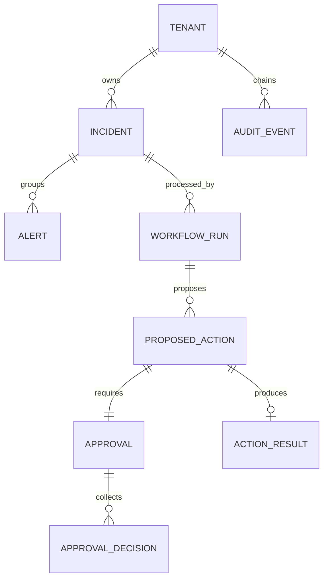

# LLD 06 — Data Model

Phase 1 uses in-memory repositories. Phase 2 adds PostgreSQL implementations of the
same repository protocols (`providers/storage/postgres/`); the repository contract tests
in `tests/contracts/` run against both whenever `TEST_DATABASE_URL` is set (always in CI,
which starts a `postgres:16` service).

**As built:** each aggregate is one row. Parts that only ever load with their parent
(`entities`, `alert_ids`, an approval's `action` and `decisions`, a run's `initiator`)
are `jsonb` columns, so a row maps 1:1 to a frozen domain object and the mapping code
stays small; everything the application filters or sorts by is a real column. The
executable schema is `providers/storage/postgres/schema.sql` (idempotent, applied at
start-up by `pool.apply_schema` under an advisory lock, so processes starting together
cannot race in the catalog). Values read back are type-checked by `rows.py`
accessors, so schema drift fails loudly. The fully normalised design below is the
target for when approvals or actions need querying on their own.

## 1. Entity relationships



## 2. Tables (PostgreSQL 16)

Every table has `tenant_id text not null` and `created_at timestamptz not null default now()`.

```sql
create table incidents (
  id            text primary key,
  tenant_id     text not null,
  team          text not null,
  status        text not null,
  severity      smallint not null,
  verdict       text,
  entities      jsonb not null,
  updated_at    timestamptz not null,
  version       integer not null default 1          -- optimistic locking
);
create index on incidents (tenant_id, team, status);

create table alerts (
  id            text primary key,
  tenant_id     text not null,
  incident_id   text not null references incidents(id),
  fingerprint   text not null,
  rule_id       text not null,
  observed_at   timestamptz not null,
  payload       jsonb not null                        -- untrusted raw fields
);
create index on alerts (tenant_id, fingerprint, observed_at desc);

create table workflow_runs (
  id            text primary key,                     -- also the LangGraph thread_id
  tenant_id     text not null,
  incident_id   text not null references incidents(id),
  workflow      text not null,
  version       text not null,
  initiator     text not null,
  status        text not null,                        -- queued/running/waiting/completed/failed
  attempts      integer not null default 0,
  updated_at    timestamptz not null
);

create table proposed_actions (
  id            text primary key,
  tenant_id     text not null,
  run_id        text not null references workflow_runs(id),
  kind          text not null,
  target        text not null,
  impact        text not null,
  reason        text not null,
  proposed_by   text not null
);

create table approvals (
  id             text primary key,
  tenant_id      text not null,
  action_id      text not null unique references proposed_actions(id),
  required_role  text not null,
  required_count smallint not null,
  status         text not null,
  expires_at     timestamptz not null
);

create table approval_decisions (
  approval_id   text not null references approvals(id),
  approver_id   text not null,
  approved      boolean not null,
  reason        text not null,
  decided_at    timestamptz not null,
  primary key (approval_id, approver_id)              -- DB-level "distinct approvers"
);

create table action_results (
  action_id       text primary key references proposed_actions(id),
  idempotency_key text not null unique,
  succeeded       boolean not null,
  detail          text not null,
  executed_at     timestamptz not null
);

create table audit_events (
  tenant_id   text not null,
  seq         bigint not null,
  at          timestamptz not null,
  actor       text not null,
  verb        text not null,
  resource    text not null,
  outcome     text not null,
  details     jsonb not null,
  prev_hash   char(64) not null,
  hash        char(64) not null,
  primary key (tenant_id, seq)
);
```

LangGraph checkpoint tables are created and owned by `langgraph-checkpoint-postgres`
(`PostgresSaver.setup()`); we never write to them directly.

## 3. Integrity and concurrency

- **Optimistic locking** on `incidents.version` (planned; today one run owns an incident at a time, so updates are last-writer-wins): updates use `where id = $1 and version = $2`;
  0 rows → `ConflictError`, caller retries from fresh state.
- **Audit sequence**: appended inside one transaction holding a per-tenant advisory lock
  (`pg_advisory_xact_lock(hashtext(tenant_id))`), so `seq` stays gap-free and the chain
  linear even for a tenant's very first event; a contract test appends from 8 threads.
- **Idempotent actions**: `action_results.idempotency_key` unique constraint; a duplicate
  insert means the action already ran → return the stored result.
- **DB grants**: app role has `insert, select` only on `audit_events` (no update/delete).

## 4. Multi-tenancy (Phase 4)

Row-level security on every table:

```sql
alter table incidents enable row level security;
create policy tenant_isolation on incidents
  using (tenant_id = current_setting('app.tenant_id'));
```

The repository sets `set local app.tenant_id = $1` at the start of each transaction from
the authenticated principal. Application-level tenant checks stay in place (defence in depth).

## 5. Redis keys (Phase 3)

| Key | Type | Purpose |
|---|---|---|
| `sf:runs:visible` | sorted set | Message id → epoch-ms it becomes claimable (ADR 0008) |
| `sf:runs:payload` / `sf:runs:attempts` | hash | Encoded command / claim count per message |
| `sf:runs:seq` | string (counter) | Ordered message ids |
| `sf:runs:dlq` | list | Dead-lettered commands with reason |
| `sf:ratelimit:{tenant}:{bucket}` | string (counter, TTL) | API rate limiting |
| `sf:budget:{tenant}:{yyyymmdd}` | string (counter, TTL 48 h) | Daily LLM token usage |
| `sf:dedup:{tenant}:{fingerprint}` | string (TTL = window) | Fast dedup lookup before DB |

## 6. Retention

| Data | Retention |
|---|---|
| Alerts, incidents, runs | 180 days (configurable) |
| Checkpoints | Deleted 7 days after run completion |
| Audit events | 1 year; never updated; partition by month for cheap archival |
