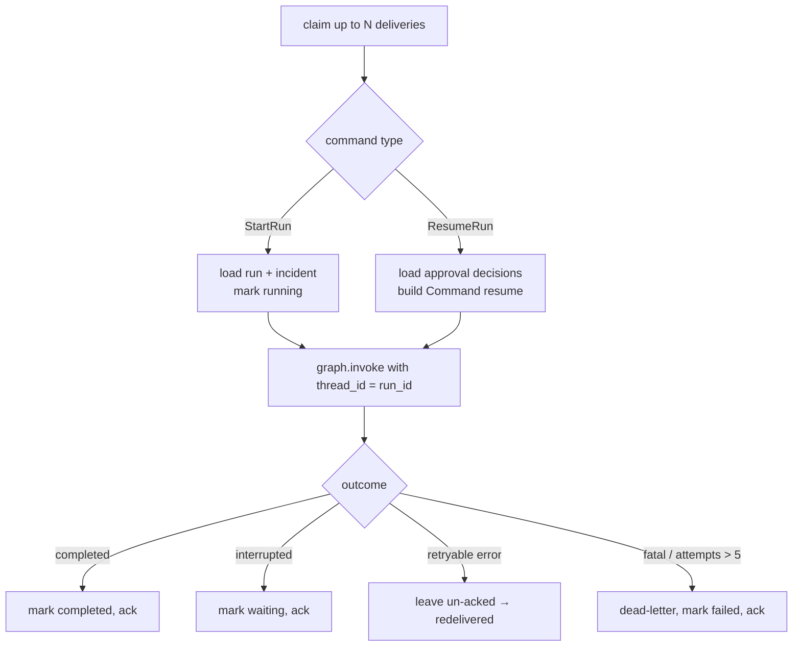

# LLD 07 — Execution Runtime

## 1. Commands

**Phase 1 (built):** `contracts/run_queue.py` defines `StartRun(run_id, tenant_id, workflow,
incident_id, alert_id, initiator)` and `Delivery(id, command, attempt)` as frozen dataclasses;
`MemoryRunQueue` redelivers unacked messages after a visibility timeout measured with the
injected `Clock`. **Phase 3 (built):** `RedisRunQueue` (ADR 0008) passes the same
contract tests; `providers/queue/command_codec.py` serialises commands as JSON tagged
`{"type": "start" | "resume", ...}` and validates every field on decode. `QUEUE_BACKEND=redis`
selects it, so API processes and any number of workers share one queue. The versioned
Pydantic shape originally planned is kept below for reference:

```python
class StartRun(BaseModel):
    type: Literal["start_run"] = "start_run"
    schema_version: int = 1
    run_id: str
    tenant_id: str
    workflow: str
    incident_id: str
    initiator: str                # principal subject; full principal re-loaded by worker

class ResumeRun(BaseModel):
    type: Literal["resume_run"] = "resume_run"
    schema_version: int = 1
    run_id: str
    tenant_id: str
    approval_id: str

RunCommand = Annotated[StartRun | ResumeRun, Field(discriminator="type")]
```

Commands carry **IDs, not data**. The worker re-reads current state from the database, so
a stale or forged message cannot inject a decision.

## 2. Worker loop



Code split (each file ≤ 100 lines):

| Module | Responsibility | Phase |
|---|---|---|
| `runtime/worker.py` | `Worker.run_once()`: claim a batch → handler → ack / leave for retry / dead-letter | 1 ✅ |
| `runtime/start_handler.py` | `StartRunHandler`: run record → `RUNNING`, `run_lifecycle`, → `WAITING`/`COMPLETED` | 1–2 ✅ |
| `runtime/dispatch.py` | `Dispatcher`: `StartRun` → start handler, `ResumeRun` → resume handler | 2 ✅ |
| `runtime/resume_handler.py` | `ResumeRunHandler`: `resume_lifecycle`; run → `WAITING` or `COMPLETED` | 2 ✅ |
| `runtime/outcome.py` | Run status bookkeeping; graceful shutdown on SIGTERM | 3 |

Failure classification (`worker.py`): `ProviderError(retryable=True)` or an unexpected
exception → left unacked for redelivery until `max_attempts` (default 5), then dead-lettered
with `"gave up after N attempts: …"`; any other `SentinelFlowError` (not found, denied,
invalid) is deterministic → dead-lettered immediately.

## 3. Delivery semantics

- **At-least-once** delivery from the queue.
- **Exactly-once effects** via: checkpointer (graph resumes after last completed node)
  + idempotency keys on actions + unique constraints on results.
- Crashed worker: its pending messages are re-claimed by others after
  `visibility_timeout` (default 60 s) with `XAUTOCLAIM`.
- Phase 1 `MemoryRunQueue` implements the same protocol with a deque, so the worker
  logic is fully unit-testable without Redis.
- **Checkpointer by storage backend** (`bootstrap/_stores.py`, `_pg_stores.py`):
  `STORAGE_BACKEND=memory` uses `InMemorySaver`; `postgres` uses LangGraph's
  `PostgresSaver` on its own autocommit pool (`providers/storage/postgres/checkpointer.py`,
  tables created by `setup()` at start-up). Because state holds ids only (ADR 0007), a
  run paused in one process resumes in another: `tests/unit/bootstrap/test_postgres_runtime.py`
  pauses a run, discards the runtime and finishes the run from a fresh one.

## 4. Retries

| Failure | Handling |
|---|---|
| Provider timeout / 5xx / rate-limited | Node-level `RetryPolicy` (3 attempts, exponential back-off with jitter) |
| Node still failing | Exception bubbles; message not acked → redelivered later |
| Same message failing > 5 deliveries | Dead-letter + `run.failed` audit + incident `ESCALATED` |
| Validation / policy errors | Not retried (deterministic); handled inside the graph |

## 5. Rate limiting (API)

Fixed-window counter per tenant and route group (`ingest`, `read`, `write`) in Redis.
Defaults: ingest 50 req/s, others 20 req/s. Exceeding returns 429 with `Retry-After`.

**As built (3.3):** `security/throttle.py` (`route_group`, `DEFAULT_LIMITS`, `Throttle`) runs
inside `Auth.current_principal` right after the token is verified, so the tenant comes from
the token, never the request. Counters sit behind `contracts/rate_limit.RateLimiter`:
`MemoryRateLimiter` per process, `RedisRateLimiter` (`sf:ratelimit:{tenant}:{group}:{window}`,
`INCR` + `PEXPIRE`) when `QUEUE_BACKEND=redis`, so all API replicas share one limit.
Unauthenticated routes (health, dev-token) are not throttled.

## 6. LLM budget

`BudgetTracker` wraps every `LLMProvider` call:

1. Before the call: if `used_today(tenant) >= budget` → `BudgetExceededError` (graph routes to
   `NEEDS_REVIEW` / human, never silently skips security steps).
2. After the call: add `usage.input_tokens + usage.output_tokens`.

Implemented as a decorator provider (`BudgetedLLM(inner: LLMProvider, tracker)`) — the
open/closed principle in action: no workflow code changes.

**As built (3.3):** `providers/llm/budgeted_llm.py` charges each call to `Prompt.tenant_id`
(trusted metadata set by every prompt builder) **before** calling the model, using an
estimate (prompt characters / 4 + a 1 024-token output allowance); exact provider usage
can replace the estimate later without changing callers. `BudgetExceededError` is a
permanent `ProviderError`, so the existing fail-safe paths apply (triage → NEEDS_REVIEW,
investigation → playbook defaults, report → verified facts only). Budgets live behind
`contracts/token_budget.TokenBudget`: memory, or Redis `sf:budget:{tenant}:{yyyymmdd}`
(`INCRBY`, rolled back with `DECRBY` on overshoot, 48 h TTL).

## 7. Scaling model

| Load | Scale action |
|---|---|
| More alerts/s | More API replicas (stateless); dedup cache in Redis |
| Longer queue | More workers (KEDA on the size of `sf:runs:visible`) |
| Slow LLM | More workers (I/O bound); async providers in Phase 3 |
| Hot tenant | Per-tenant rate limit and budget isolate noisy neighbours |

Target for the load test (Phase 3): 1 000 alerts in 60 s with 4 workers and `FakeLLM`
(measures platform overhead, not LLM latency), then a smaller run with Ollama.

**Process layout (built, slice 3.2):** `sentinelflow-api` serves HTTP and, unless
`RUN_WORKER_IN_API=false`, runs a worker thread. `sentinelflow-worker`
(`bootstrap/worker_main.py`) is a worker-only process. Splitting them requires shared
state, so `Settings` rejects `RUN_WORKER_IN_API=false` unless `STORAGE_BACKEND=postgres`
and `QUEUE_BACKEND=redis`, and the worker refuses a memory queue. Tickets move to
PostgreSQL (`PgTicketing`) with the other stores, so a report written by a worker is
readable from every API replica. `docker-compose.yml` runs one API, two workers (scale with
`--scale worker=N`), Postgres and Redis from one non-root image (`Dockerfile`);
`scripts/smoke_test.py` posts an alert and waits for the run to pause for approval.

## 8. Graceful shutdown

On SIGTERM (built: `install_stop_signals`): stop claiming, finish the current batch
(LangGraph checkpoints after each super-step), do **not** ack unfinished work, exit.
A command killed mid-flight becomes claimable again after the visibility timeout and
another worker resumes it from its checkpoint.
