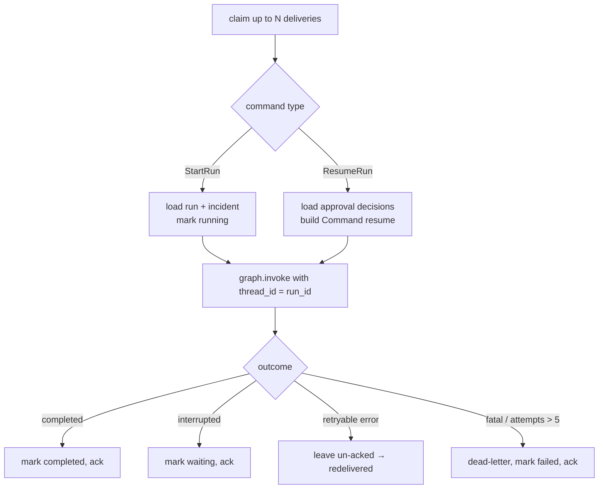

# LLD 07 — Execution Runtime

## 1. Commands

**Phase 1 (built):** `contracts/run_queue.py` defines `StartRun(run_id, tenant_id, workflow,
incident_id, alert_id, initiator)` and `Delivery(id, command, attempt)` as frozen dataclasses;
`MemoryRunQueue` redelivers unacked messages after a visibility timeout measured with the
injected `Clock`. Phase 3 serialises commands for Redis as the versioned Pydantic models below:

```python
class StartRun(BaseModel):
    type: Literal["start_run"] = "start_run"
    schema_version: int = 1
    run_id: str
    tenant_id: str
    workflow: str
    incident_id: str
    initiator: str                # principal subject; full principal re-loaded by worker

class ResumeRun(BaseModel):
    type: Literal["resume_run"] = "resume_run"
    schema_version: int = 1
    run_id: str
    tenant_id: str
    approval_id: str

RunCommand = Annotated[StartRun | ResumeRun, Field(discriminator="type")]
```

Commands carry **IDs, not data**. The worker re-reads current state from the database, so
a stale or forged message cannot inject a decision.

## 2. Worker loop



Code split (each file ≤ 100 lines):

| Module | Responsibility | Phase |
|---|---|---|
| `runtime/worker.py` | `Worker.run_once()`: claim a batch → handler → ack / leave for retry / dead-letter | 1 ✅ |
| `runtime/start_handler.py` | `StartRunHandler`: load incident + alert, `run_lifecycle`, save incident | 1 ✅ |
| `runtime/dispatch.py` | Map command type → handler | 2 |
| `runtime/resume_handler.py` | Rebuild decision from DB, resume graph | 2 |
| `runtime/outcome.py` | Run status bookkeeping; graceful shutdown on SIGTERM | 3 |

Failure classification (`worker.py`): `ProviderError(retryable=True)` or an unexpected
exception → left unacked for redelivery until `max_attempts` (default 5), then dead-lettered
with `"gave up after N attempts: …"`; any other `SentinelFlowError` (not found, denied,
invalid) is deterministic → dead-lettered immediately.

## 3. Delivery semantics

- **At-least-once** delivery from the queue.
- **Exactly-once effects** via: checkpointer (graph resumes after last completed node)
  + idempotency keys on actions + unique constraints on results.
- Crashed worker: its pending messages are re-claimed by others after
  `visibility_timeout` (default 60 s) with `XAUTOCLAIM`.
- Phase 1 `MemoryRunQueue` implements the same protocol with a deque, so the worker
  logic is fully unit-testable without Redis.

## 4. Retries

| Failure | Handling |
|---|---|
| Provider timeout / 5xx / rate-limited | Node-level `RetryPolicy` (3 attempts, exponential back-off with jitter) |
| Node still failing | Exception bubbles; message not acked → redelivered later |
| Same message failing > 5 deliveries | Dead-letter + `run.failed` audit + incident `ESCALATED` |
| Validation / policy errors | Not retried (deterministic); handled inside the graph |

## 5. Rate limiting (API)

Fixed-window counter per tenant and route group (`ingest`, `read`, `write`) in Redis.
Defaults: ingest 50 req/s, others 20 req/s. Exceeding returns 429 with `Retry-After`.

## 6. LLM budget

`BudgetTracker` wraps every `LLMProvider` call:

1. Before the call: if `used_today(tenant) >= budget` → `BudgetExceededError` (graph routes to
   `NEEDS_REVIEW` / human, never silently skips security steps).
2. After the call: add `usage.input_tokens + usage.output_tokens`.

Implemented as a decorator provider (`BudgetedLLM(inner: LLMProvider, tracker)`) — the
open/closed principle in action: no workflow code changes.

## 7. Scaling model

| Load | Scale action |
|---|---|
| More alerts/s | More API replicas (stateless); dedup cache in Redis |
| Longer queue | More workers (KEDA on `XPENDING` / stream length) |
| Slow LLM | More workers (I/O bound); async providers in Phase 3 |
| Hot tenant | Per-tenant rate limit and budget isolate noisy neighbours |

Target for the load test (Phase 3): 1 000 alerts in 60 s with 4 workers and `FakeLLM`
(measures platform overhead, not LLM latency), then a smaller run with Ollama.

## 8. Graceful shutdown

On SIGTERM: stop claiming, finish the current node (LangGraph checkpoints after each
super-step), do **not** ack unfinished work, exit. Another worker resumes it.
